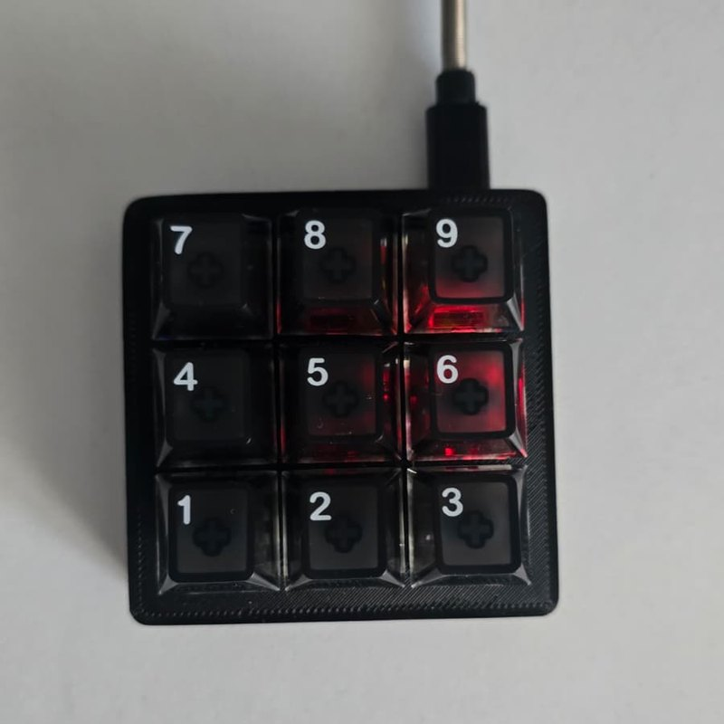
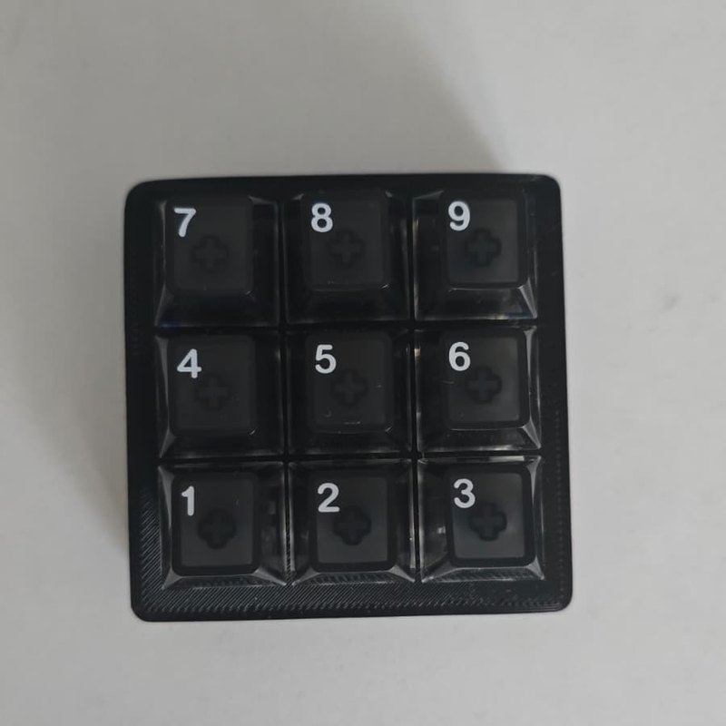
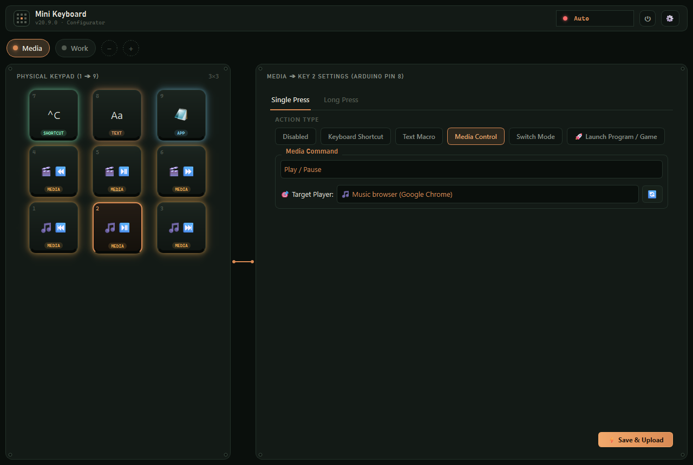
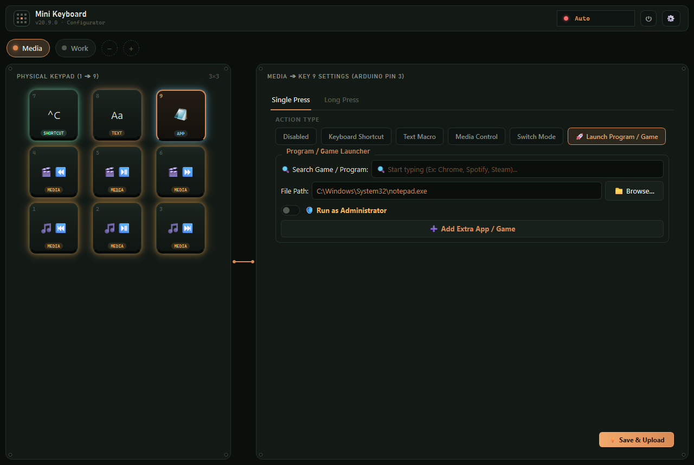
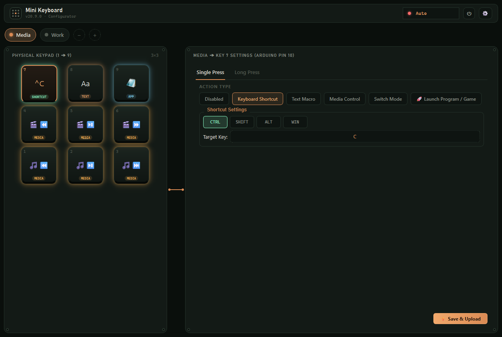
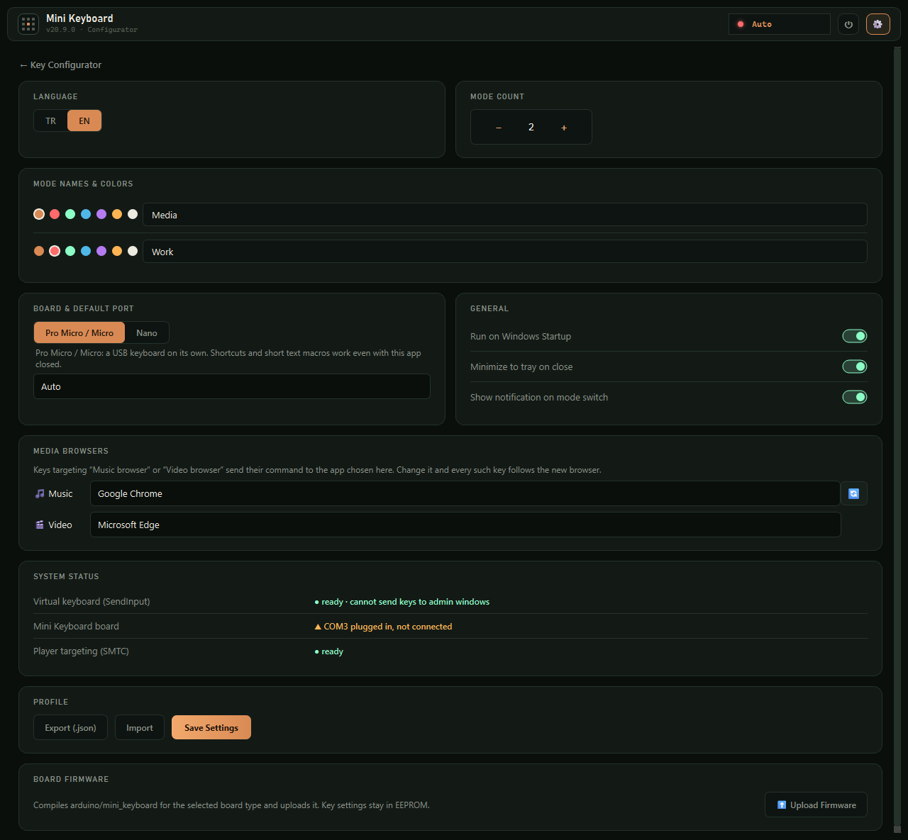
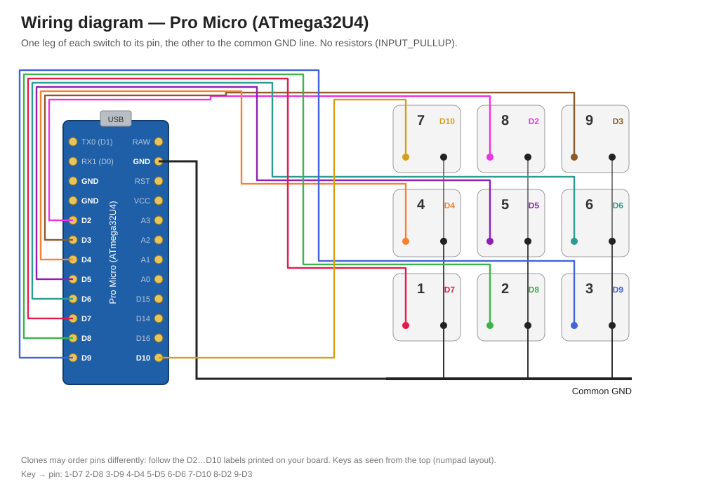
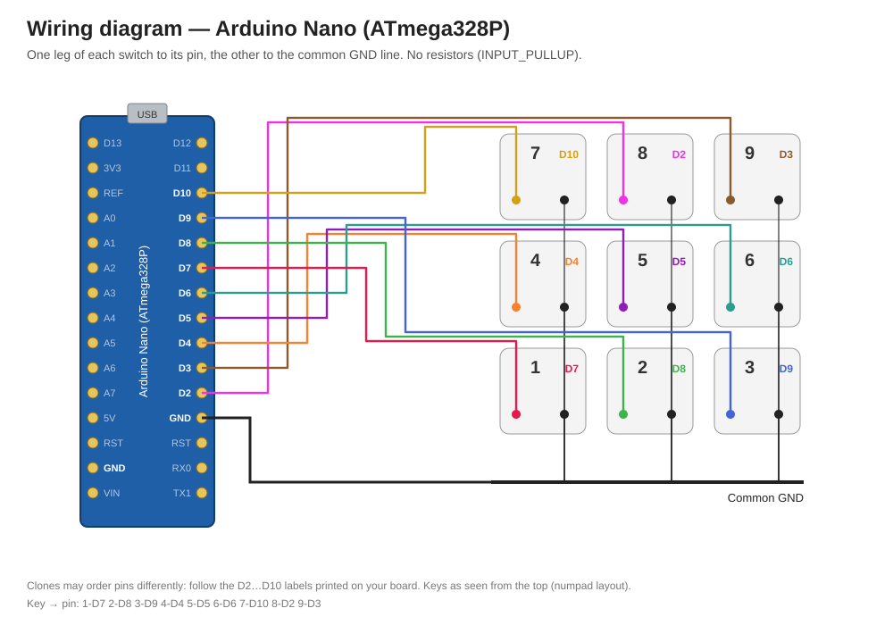
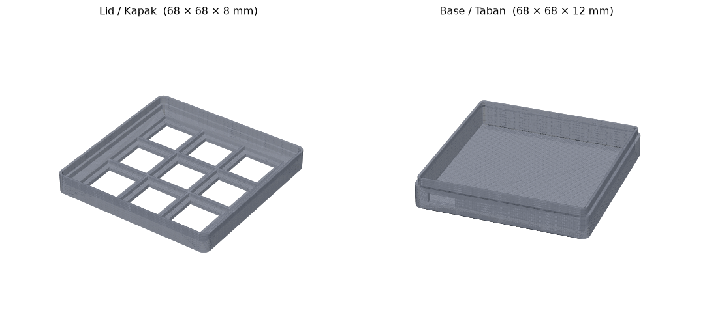

# ⌨️ Mini Keyboard — Arduino 3×3 Macro Pad

[🇹🇷 Türkçe](README.tr.md)

<p align="center">
  
  
</p>

Firmware and a Windows desktop configurator for a 9-key (3×3) macro pad built on an
Arduino Pro Micro / Micro (ATmega32U4) or an Arduino Nano (ATmega328P) — see [Hardware](#hardware) for the difference.

## Features

- **Single press and long press** on each of the 9 keys, with a library-free debounce.
- **Two board options**: Pro Micro / Micro acts as a USB keyboard by itself; a Nano works through the desktop app.
- **Settings stored in EEPROM**: on a Pro Micro / Micro shortcuts keep working with the desktop app closed
  (text macros up to ~7 characters fit on the board; no length limit while the PC is connected).
- **Up to 5 modes**, each with its own color and optional name.
- **Action types**: keyboard shortcut, text macro (typed or pasted), media command,
  mode switch, launch program/game (optionally as administrator).
- **Targeted media control (Windows SMTC)**: play/pause, next, previous and ±10 s seek can be
  sent to one specific player instead of whatever Windows picks.
- **Music & video browser roles**: in *Settings → Media Browsers* choose which browser (Chrome,
  Edge, Brave, Opera, Vivaldi, Helium, Firefox, or any open player) plays your music and which one
  plays your videos. Keys set to *Music browser* / *Video browser* follow that choice — change the
  browser once and every such key moves with it.
- **One-click firmware upload** from the app via `arduino-cli`.
- **Profile export/import** as JSON.
- Dark PyQt6 interface, live COM port detection, system tray, full Turkish and English UI.

No extra software is needed for the media features: they use Windows' own media controls
(SMTC) through the built-in Windows PowerShell. Only the firmware upload button needs the Arduino IDE or `arduino-cli`.

## Screenshots

<table>
  <tr>
    <td></td>
    <td></td>
  </tr>
  <tr>
    <td></td>
    <td></td>
  </tr>
</table>

## Hardware

The pad works with two kinds of Arduino boards. The wiring is identical; what differs is how the board talks to the PC.

| | Pro Micro / Micro / Leonardo (ATmega32U4) | Nano / Uno (ATmega328P) |
| :--- | :--- | :--- |
| USB | Built into the microcontroller | Separate USB-serial bridge chip (CH340, FT232R, CP2102) |
| Acts as a USB keyboard | Yes | No |
| Works with the app closed | Shortcuts and text macros (up to ~7 characters) | No, every action is performed by the app |
| Port detection | Automatic | You pick the COM port once (Settings → Board & Default Port) |
| Firmware build | `arduino:avr:micro` | `arduino:avr:nano` (new or old bootloader, tried automatically) |

**Why a Nano can't be a keyboard:** a USB keyboard has to describe itself to the PC as a HID device (USB descriptors). The ATmega32U4 has a USB controller on the chip, so the firmware can do that. The ATmega328P on a Nano only has a UART; the bridge chip next to it always presents itself as a virtual COM port and nothing else. So the Nano firmware only reports "key N was pressed" over serial and the desktop app turns that into keystrokes, media commands or app launches with Windows' own input API.

**Why there's no auto-search on a Nano:** opening a Nano's serial port toggles the bridge chip's DTR line, which resets the board (this is how uploads work without a reset button). Probing every USB-serial port would reset any other Arduino on the PC, so in Nano mode the app only opens the port you chose. After opening, it waits up to 3.5 s for the bootloader to hand over.

### Wiring diagrams

**Pro Micro**



**Nano**



### Wiring (both boards)

| Key | Pin |
| :--- | :--- |
| Key 1 (bottom left) | D7 |
| Key 2 (bottom middle) | D8 |
| Key 3 (bottom right) | D9 |
| Key 4 (middle left) | D4 |
| Key 5 (center) | D5 |
| Key 6 (middle right) | D6 |
| Key 7 (top left) | D10 |
| Key 8 (top middle) | D2 |
| Key 9 (top right) | D3 |

Wire one leg of each button to its pin and the other leg to GND. The internal `INPUT_PULLUP`
resistors are used, so no external resistors are needed. D0/D1 are left free (they are the Nano's serial lines).

## Bill of materials

| Part | Qty | Notes |
| :--- | :---: | :--- |
| Arduino Pro Micro (ATmega32U4, 5 V / 16 MHz) **or** Arduino Nano (ATmega328P) | 1 | USB-C or micro-USB; see [Hardware](#hardware) for the difference |
| MX-compatible mechanical switch | 9 | 3- or 5-pin, snaps into the 14 × 14 mm plate cut-outs |
| MX keycap, 1u | 9 | Any MX-stem keycap |
| Hook-up wire | ~1 m | Thin (26–28 AWG) stranded or silicone wire: 9 signal wires + a GND chain |
| USB cable | 1 | Matching the board's connector |
| 3D-printed lid + base | 1 set | `hardware/case/`, ~27 g of PLA at 100 % infill (base 13.5 cm³, lid 8.6 cm³) |
| Double-sided tape or hot glue | — | Holds the board on the floor of the base |

Tools: soldering iron, solder, side cutters. **No resistors, diodes or PCB are needed.** Every key has its own pin and the chip's internal pull-up resistors are used. Diodes are only needed in a key *matrix* (rows × columns sharing pins), where they stop "ghost" presses; with one pin per key that problem doesn't exist.

## Case (3D printing)



- `hardware/case/lid.stl` and `base.stl`, in **millimetres**.
- `hardware/case/build_case.py` regenerates both from a few numbers (`pip install manifold3d trimesh numpy`).
- **Print** both parts as they are in the file (flat side down): no supports needed. 0.2 mm layers; the 2 mm walls come out solid with 4–5 perimeters on a 0.4 mm nozzle. The lid prints plate-face down, so the visible top is the smooth bed side.
- **Fit:** the lid's 0.9 mm skirt slides over the base's 0.9 mm lip with 0.2 mm clearance per side (`FIT_GAP` in `build_case.py`). All inner corners share the outer corners' centre, so the walls keep their thickness in the corners too.
- **Board:** lies flat on the 2 mm floor with its USB connector in the 11 × 4 mm opening (the opening is centred 5 mm above the bottom). On a Nano don't solder pin headers (solder the wires straight to the pads), otherwise the connector sits too high.
- **Switch plate:** 1.5 mm thick at the cut-outs, the MX spec, so the switch clips lock in.

## Firmware

One sketch, `arduino/mini_keyboard/mini_keyboard.ino`, builds for both boards: the keyboard code is only compiled when the chip has native USB (`USBCON`).

- **From the app:** Settings → choose the board type → **Upload Firmware** (needs Arduino IDE 2.x or `arduino-cli` with the AVR core).
- **From the Arduino IDE:** open the sketch, select **Arduino Micro** (Pro Micro clones too) or **Arduino Nano**. For most CH340 Nano clones choose *Processor → ATmega328P (Old Bootloader)*.

Measured build size (arduino-cli, AVR core 1.8.8):

| Board | Flash | RAM (globals) |
| :--- | :--- | :--- |
| Micro / Pro Micro | 12 172 bytes of 28 672 | 1 298 bytes of 2 560 |
| Nano | 7 302 bytes of 30 720 | 1 256 bytes of 2 048 |

## Desktop app (Windows 10 1809+ / 11, Python 3.9+)

```bash
pip install -r requirements.txt
python gui/main.py --show
```

- On first launch the app loads `user_config.example.json` as a starting profile. Your own
  settings are saved to `user_config.json` (ignored by git).
- The app starts hidden in the system tray; `--show` opens the window. It also creates a
  **Mini Keyboard Configurator** shortcut on the desktop.
- Targeted media control uses Windows PowerShell 5.1 (`powershell.exe`, built into Windows).
- Sending keys to a window running as administrator requires running the app as administrator.

### Media browsers

1. Start playing something in your browser.
2. Open **Settings → Media Browsers**, pick the browser for *Music* and *Video* (🔄 refreshes the
   list of open players).
3. In a key's *Media Command*, set **Target Player** to *🎵 Music browser* or *🎬 Video browser*.

If a role is not set, the key works system-wide. Seeking (±10 s) only works if the player supports
changing the playback position.

## Running in the background & resource use

The app is meant to stay running: it starts hidden in the system tray (optionally with Windows) and has to be running for media commands, app launches and — on a Nano — every key. Closing the window only hides it; *Quit* in the tray menu exits.

Measured on Windows 11 with Python 3.14, app idle in the tray, board connected, over 2 minutes:

| Process | CPU time | Private memory | Threads |
| :--- | :--- | :--- | :--- |
| Mini Keyboard (Python/PyQt6) | 78 ms per minute | 46 MB | 11 |
| Media helper (`powershell.exe`, kept running for SMTC) | 16 ms per minute | 32 MB | 15 |
| **Total** | **~94 ms per minute** | **~78 MB** | |

Windows counts CPU time in ~15.6 ms steps, so small values are only that precise.

What a key press costs (from the code and earlier measurements):

- Debounce 15 ms; a press longer than 350 ms is a long press.
- Serial wait in the app: the read blocks for at most 50 ms, a byte on the wire wakes it immediately.
- Targeted media command: ~250 ms for the very first one (PowerShell + WinRT load, done at startup in the background), then 1–6 ms each because the helper process stays open. Without the persistent helper every press cost ~265 ms.
- Shortcuts and text are sent with Windows `SendInput`; app launches run on a background queue so a slow program start never blocks the next key.

## Project layout

- `arduino/mini_keyboard/mini_keyboard.ino` — ATmega32U4 firmware
- `gui/main.py` — PyQt6 interface
- `gui/media.py` — media keys, SMTC player targeting, music/video browser roles
- `gui/smtc.ps1` — Windows SMTC helper (runs as a persistent PowerShell process)
- `gui/key_input.py` — key simulation (SendInput), clipboard, text macros
- `gui/app_launcher.py` — installed app scan, elevated launch task, bringing running windows forward
- `gui/serial_handler.py` — serial JSON protocol
- `gui/wire_format.py` — compact wire format sent to the board
- `gui/action_queue.py` — ordered background queue for key actions
- `gui/arduino_flasher.py` — compile/upload firmware from the app
- `gui/i18n.py` — UI language (TR/EN) for runtime messages
- `user_config.example.json` — starter profile
- `hardware/case/` — case STL files and the script that builds them
- `docs/images/` — photos, wiring diagrams, case preview

Code comments are mostly in Turkish.

## License

- **Software** (`gui/`, `arduino/`, configuration files): [MIT](LICENSE).
- **Case design, photos and wiring diagrams** (`hardware/`, `docs/images/`): [CC BY-NC 4.0](hardware/LICENSE). Free to use, modify and share with credit; **commercial use is not allowed**, including selling printed cases or kits.
- The desktop app uses **PyQt6**, which is licensed under GPL v3. Using and sharing the source as it is here is fine; if you distribute a packaged build (for example an `.exe`), that build has to follow the GPL v3.
- "Arduino" and "Cherry MX" are trademarks of their owners and are used here only to describe compatibility.
