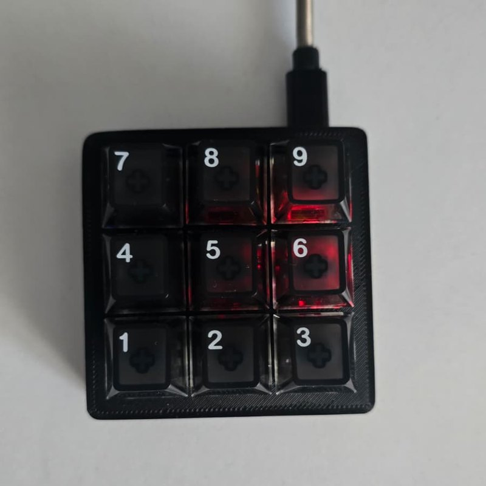
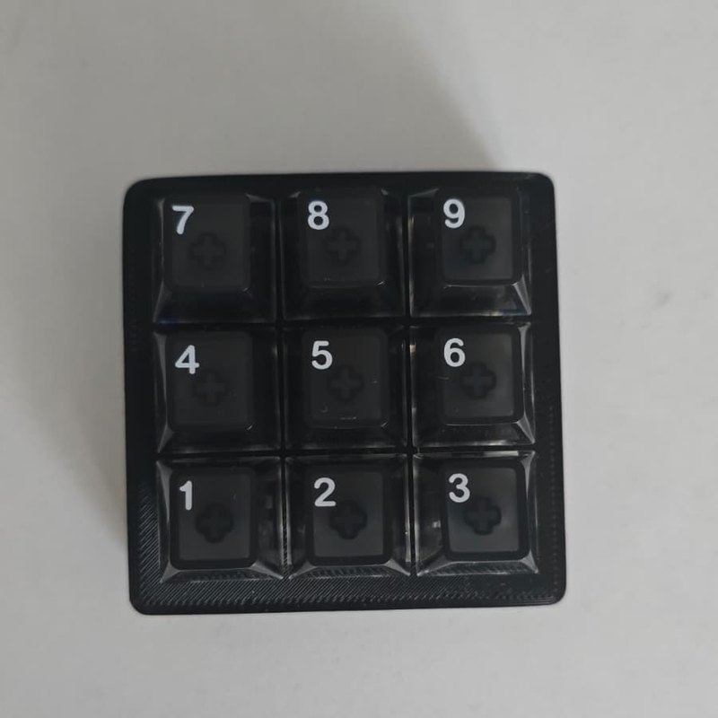
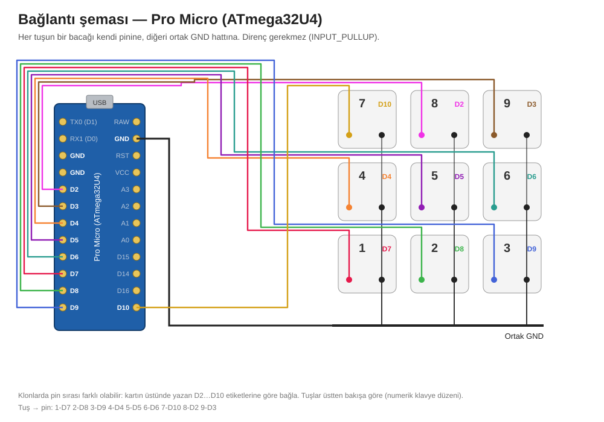
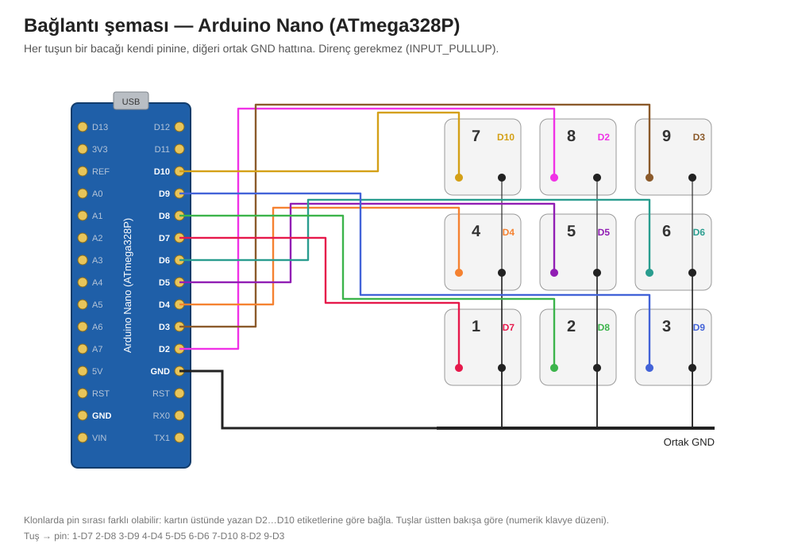
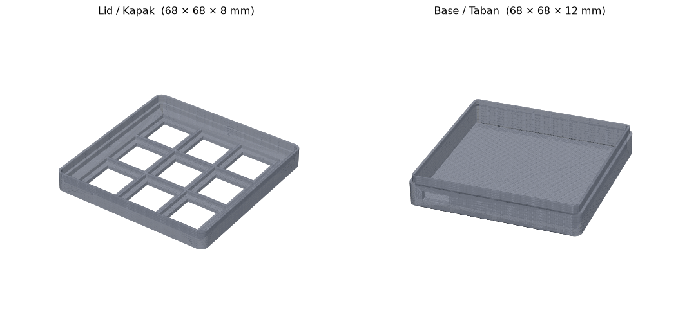

# ⌨️ Mini Keyboard — Arduino 3×3 Makro Klavye

[🇬🇧 English](README.md)

<p align="center">
  
  
</p>

Arduino Pro Micro / Micro (ATmega32U4) ya da Arduino Nano (ATmega328P) ile yapılan 9 tuşlu (3×3)
makro klavye için gömülü yazılım ve Windows masaüstü yapılandırma programı. Kartlar arasındaki fark
[Donanım](#donanım) bölümünde.

## Özellikler

- 9 tuşun her birinde **tek basış ve uzun basış**; kütüphanesiz debounce (tuş sekmesi filtresi).
- **İki kart seçeneği**: Pro Micro / Micro kendi başına USB klavyedir; Nano masaüstü programı üzerinden çalışır.
- **EEPROM'da kalıcı ayar**: Pro Micro / Micro'da masaüstü programı kapalıyken de kısayollar çalışır
  (metin makroları kartta ~7 karaktere kadar sığar; bilgisayar bağlıyken uzunluk sınırı yoktur).
- **5'e kadar mod**, her birine renk ve isteğe bağlı isim.
- **Eylem türleri**: klavye kısayolu, metin makrosu (yazarak ya da yapıştırarak), medya komutu,
  mod değiştirme, program/oyun açma (istenirse yönetici olarak).
- **Hedefli medya kontrolü (Windows SMTC)**: oynat/durdur, sonraki, önceki ve ±10 sn sarma, Windows'un
  seçtiği oynatıcıya değil doğrudan seçtiğin oynatıcıya gider.
- **Müzik ve video tarayıcısı**: *Ayarlar → Medya Tarayıcıları* bölümünde müziği hangi tarayıcının
  (Chrome, Edge, Brave, Opera, Vivaldi, Helium, Firefox ya da açık herhangi bir oynatıcı), videoyu
  hangisinin çaldığını seçersin. Hedefi *Müzik tarayıcısı* / *Video tarayıcısı* olan tuşlar bu
  seçimi izler: tarayıcıyı bir kez değiştirince o tuşların hepsi yeni tarayıcıya geçer.
- Programdan **tek tıkla firmware yükleme** (`arduino-cli`).
- **Profil dışa/içe aktarma** (JSON).
- Koyu temalı PyQt6 arayüz, canlı COM port algılama, sistem tepsisi, tamamen Türkçe ve İngilizce arayüz.

Medya özellikleri için ek program gerekmez: Windows'un kendi medya kontrolünü (SMTC) Windows'la gelen
PowerShell üzerinden kullanır. Yalnızca firmware yükleme düğmesi Arduino IDE ya da `arduino-cli` ister.

## Donanım

Klavye iki tür Arduino kartla çalışır. Kablolama aynıdır; fark, kartın bilgisayarla nasıl konuştuğundadır.

| | Pro Micro / Micro / Leonardo (ATmega32U4) | Nano / Uno (ATmega328P) |
| :--- | :--- | :--- |
| USB | Mikrodenetleyicinin içinde | Ayrı USB-seri köprü yongası (CH340, FT232R, CP2102) |
| USB klavye olarak görünür | Evet | Hayır |
| Program kapalıyken çalışır | Kısayollar ve kısa metinler (~7 karakter) | Hayır, her eylemi program yapar |
| Port bulma | Otomatik | COM portunu bir kez seçersin (Ayarlar → Kart ve Varsayılan Port) |
| Firmware derleme | `arduino:avr:micro` | `arduino:avr:nano` (yeni ya da eski bootloader, sırayla denenir) |

**Nano neden klavye olamaz:** USB klavye, bilgisayara kendini HID aygıtı olarak tanıtmak zorundadır (USB tanımlayıcıları). ATmega32U4'ün içinde USB denetleyicisi vardır, bu yüzden firmware bunu kendisi yapabilir. Nano'daki ATmega328P'de yalnızca UART (seri hat) vardır; yanındaki köprü yongası kendini her zaman sanal COM portu olarak tanıtır, başka bir şey olamaz. Bu yüzden Nano firmware'i yalnızca "N. tuşa basıldı" bilgisini seri hattan gönderir; bunu Windows'un kendi giriş arayüzüyle tuş vuruşuna, medya komutuna ya da program açmaya masaüstü programı çevirir.

**Nano'da neden otomatik arama yok:** Nano'nun seri portu açılınca köprü yongasının DTR hattı kartı sıfırlar (reset düğmesi olmadan yükleme bu sayede yapılır). Her USB-seri portu denemek, bilgisayardaki başka bir Arduino'yu da yeniden başlatırdı. Bu yüzden Nano modunda program yalnızca senin seçtiğin portu açar ve açtıktan sonra bootloader'ın bitmesi için en çok 3,5 sn bekler.

### Bağlantı şemaları

**Pro Micro**



**Nano**



### Kablolama (iki kart için aynı)

| Tuş | Pin |
| :--- | :--- |
| Tuş 1 (sol alt) | D7 |
| Tuş 2 (orta alt) | D8 |
| Tuş 3 (sağ alt) | D9 |
| Tuş 4 (sol orta) | D4 |
| Tuş 5 (merkez) | D5 |
| Tuş 6 (sağ orta) | D6 |
| Tuş 7 (sol üst) | D10 |
| Tuş 8 (orta üst) | D2 |
| Tuş 9 (sağ üst) | D3 |

Her butonun bir bacağı kendi pinine, diğer bacağı GND'ye bağlanır. Dahili `INPUT_PULLUP`
dirençleri kullanıldığı için harici direnç gerekmez. D0/D1 boş bırakılır (Nano'nun seri hattı).

## Malzeme listesi

| Parça | Adet | Not |
| :--- | :---: | :--- |
| Arduino Pro Micro (ATmega32U4, 5 V / 16 MHz) **ya da** Arduino Nano (ATmega328P) | 1 | USB-C ya da micro-USB; fark için [Donanım](#donanım) |
| MX uyumlu mekanik anahtar (switch) | 9 | 3 ya da 5 bacaklı, plakadaki 14 × 14 mm deliklere oturur |
| MX tuş kapağı, 1u | 9 | MX saplı herhangi bir tuş kapağı |
| Bağlantı kablosu | ~1 m | İnce (26–28 AWG) çok telli ya da silikon kablo: 9 sinyal kablosu + GND zinciri |
| USB kablosu | 1 | Kartın girişine uygun |
| 3D baskı kapak + taban | 1 takım | `hardware/case/`, %100 dolulukta ~27 g PLA (taban 13,5 cm³, kapak 8,6 cm³) |
| Çift taraflı bant ya da sıcak silikon | — | Kartı tabanın zeminine sabitlemek için |

Aletler: havya, lehim, yan keski. **Direnç, diyot ya da baskı devre gerekmez.** Her tuşun kendi pini var ve yongadaki dahili pull-up dirençleri kullanılıyor. Diyot yalnızca tuş *matrisinde* (satır × sütun, pinler paylaşılır) gerekir; orada "hayalet" basışları engeller. Tuş başına bir pin olunca bu sorun hiç oluşmaz.

## Kasa (3D baskı)



- `hardware/case/lid.stl` (kapak) ve `base.stl` (taban), birim **milimetre**.
- `hardware/case/build_case.py` iki parçayı birkaç sayıdan yeniden üretir (`pip install manifold3d trimesh numpy`).
- **Baskı:** iki parçayı da dosyadaki gibi (düz yüzü aşağıda) bas, destek gerekmez. 0,2 mm katman; 0,4 mm nozulda 4–5 duvar çizgisiyle 2 mm duvarlar tamamen dolu çıkar. Kapak plaka yüzü aşağıda basılır, böylece görünen üst yüz tablaya değen pürüzsüz taraf olur.
- **Oturma:** kapağın 0,9 mm eteği tabanın 0,9 mm dudağının üstüne her yanda 0,2 mm boşlukla geçer (`build_case.py` içinde `FIT_GAP`). Bütün iç köşeler dış köşelerle aynı merkezli olduğu için duvarlar köşelerde de incelmez.
- **Kart:** 2 mm zeminin üstüne düz yatar, USB girişi 11 × 4 mm açıklığa denk gelir (açıklığın merkezi alttan 5 mm). Nano'da pin başlıklarını (header) lehimleme, kabloları doğrudan pedlere lehimle; yoksa giriş fazla yukarıda kalır.
- **Anahtar plakası:** delik bölgesinde 1,5 mm, yani MX standardı; anahtarların klipsleri yerine oturur.

## Firmware

Tek bir kod, `arduino/mini_keyboard/mini_keyboard.ino`, iki kart için de derlenir: klavye kodu yalnızca yongada yerleşik USB varsa (`USBCON`) derlenir.

- **Programdan:** Ayarlar → kart türünü seç → **Firmware'i Karta Yükle** (Arduino IDE 2.x ya da AVR çekirdeği kurulu `arduino-cli` gerekir).
- **Arduino IDE'den:** kodu aç, kart olarak **Arduino Micro** (Pro Micro klonları da) ya da **Arduino Nano** seç. CH340'lı Nano klonlarının çoğunda *Processor → ATmega328P (Old Bootloader)* seçilir.

Ölçülen derleme boyutu (arduino-cli, AVR çekirdeği 1.8.8):

| Kart | Program belleği | RAM (global değişkenler) |
| :--- | :--- | :--- |
| Micro / Pro Micro | 12 172 / 28 672 bayt | 1 298 / 2 560 bayt |
| Nano | 7 302 / 30 720 bayt | 1 256 / 2 048 bayt |

## Masaüstü programı (Windows 10 1809+ / 11, Python 3.9+)

```bash
pip install -r requirements.txt
python gui/main.py --show
```

- İlk açılışta program `user_config.example.json` dosyasını başlangıç profili olarak yükler. Senin
  ayarların `user_config.json` dosyasına kaydedilir (git bu dosyayı yok sayar).
- Program sistem tepsisinde gizli başlar; `--show` pencereyi açar. Masaüstüne
  **Mini Keyboard Configurator** kısayolu da oluşturur.
- Hedefli medya kontrolü Windows PowerShell 5.1'i (`powershell.exe`, Windows'la gelir) kullanır.
- Yönetici olarak çalışan bir pencereye tuş göndermek için programın da yönetici olarak çalışması gerekir.

### Medya tarayıcıları

1. Tarayıcında bir şey çalmaya başla.
2. **Ayarlar → Medya Tarayıcıları** bölümünde *Müzik* ve *Video* için tarayıcıyı seç (🔄 açık
   oynatıcıların listesini yeniler).
3. Bir tuşun *Medya Komutu* ayarında **Hedef Oynatıcı**'yı *🎵 Müzik tarayıcısı* ya da
   *🎬 Video tarayıcısı* yap.

Rol seçilmemişse tuş sistem geneli çalışır. Sarma (±10 sn) yalnızca oynatıcı konum değiştirmeyi
destekliyorsa çalışır.

## Arka planda çalışma ve kaynak kullanımı

Program sürekli açık kalmak için tasarlandı: sistem tepsisinde gizli başlar (istenirse Windows'la birlikte) ve medya komutları, program açma ve Nano'da her tuş için açık olması gerekir. Pencereyi kapatmak yalnızca gizler; tepsi menüsündeki *Tamamen Çıkış Yap* kapatır.

Windows 11, Python 3.14, program tepside boşta, kart bağlı, 2 dakika boyunca ölçüldü:

| Süreç | İşlemci zamanı | Özel bellek | İş parçacığı |
| :--- | :--- | :--- | :--- |
| Mini Keyboard (Python/PyQt6) | dakikada 78 ms | 46 MB | 11 |
| Medya yardımcısı (`powershell.exe`, SMTC için açık tutulur) | dakikada 16 ms | 32 MB | 15 |
| **Toplam** | **dakikada ~94 ms** | **~78 MB** | |

Windows işlemci zamanını ~15,6 ms'lik adımlarla sayar; küçük değerler ancak bu kadar hassastır.

Bir tuş basışının maliyeti (koddan ve önceki ölçümlerden):

- Tuş sekmesi filtresi 15 ms; 350 ms'den uzun basış uzun basıştır.
- Programın seri hattı beklemesi en çok 50 ms; hatta bir bayt gelince hemen uyanır.
- Hedefli medya komutu: ilki ~250 ms (PowerShell + WinRT yüklemesi, açılışta arka planda yapılır), sonrakiler 1–6 ms, çünkü yardımcı süreç açık kalır. Kalıcı yardımcı olmadan her basış ~265 ms sürüyordu.
- Kısayol ve metinler Windows `SendInput` ile gönderilir; program açma arka plan kuyruğunda çalışır, yavaş açılan bir program sonraki tuşu bekletmez.

## Dosya yapısı

- `arduino/mini_keyboard/mini_keyboard.ino` — ATmega32U4 gömülü yazılımı
- `gui/main.py` — PyQt6 arayüzü
- `gui/media.py` — medya tuşları, SMTC hedefli oynatıcı, müzik/video tarayıcısı rolleri
- `gui/smtc.ps1` — Windows SMTC yardımcısı (kalıcı tek PowerShell süreci)
- `gui/key_input.py` — tuş simülasyonu (SendInput), pano, metin makrosu
- `gui/app_launcher.py` — kurulu uygulama taraması, yönetici görevi, açık pencereyi öne getirme
- `gui/serial_handler.py` — seri port JSON haberleşmesi
- `gui/wire_format.py` — karta giden kısa seri hat biçimi
- `gui/action_queue.py` — tuş eylemleri için sıralı arka plan kuyruğu
- `gui/arduino_flasher.py` — programdan firmware derleme/yükleme
- `gui/i18n.py` — anlık mesajlar için arayüz dili (TR/EN)
- `user_config.example.json` — başlangıç profili
- `hardware/case/` — kasa STL dosyaları ve onları üreten script
- `docs/images/` — fotoğraflar, bağlantı şemaları, kasa önizlemesi

## Lisans

- **Yazılım** (`gui/`, `arduino/`, ayar dosyaları): [MIT](LICENSE).
- **Kasa tasarımı, fotoğraflar ve bağlantı şemaları** (`hardware/`, `docs/images/`): [CC BY-NC 4.0](hardware/LICENSE). Ad verilerek serbestçe kullanılabilir, değiştirilebilir ve paylaşılabilir; **ticari kullanım yasaktır**, basılmış kasa ya da kit satmak dahil.
- Masaüstü programı GPL v3 lisanslı **PyQt6** kullanır. Kaynak kodu buradaki gibi kullanmak ve paylaşmak serbesttir; paketlenmiş bir sürüm (örneğin `.exe`) dağıtılırsa o paket GPL v3'e uymak zorundadır.
- "Arduino" ve "Cherry MX" sahiplerinin ticari markalarıdır; burada yalnızca uyumluluğu belirtmek için geçer.
